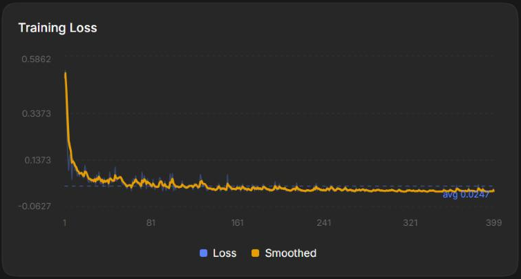
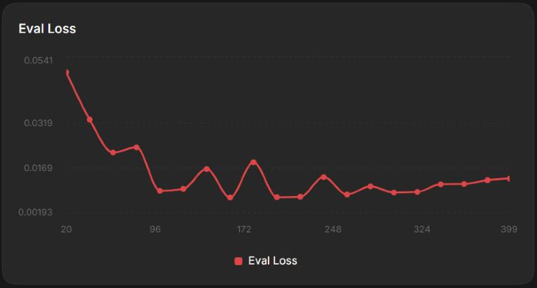

# Llama-3.1-8B-triage-anthropic

Customer message triage for a (fake) Malaysian online shop. Took Llama 3.1 8B Instruct, did QLoRA on it in Unsloth Studio, and now it spits out JSON for every message. **Built with Llama.**

Model is here: [Samir-syazwan/Llama-3.1-8B-triage-anthropic](https://huggingface.co/Samir-syazwan/Llama-3.1-8B-triage-anthropic). It's a LoRA adapter, final run is **1795745604**.

## what it does

Give it a message, get back three labels (rules are in [`LABELING_GUIDE.md`](LABELING_GUIDE.md)):

```
in:  Not urgent at all, but my kettle caught fire this morning.
out: {"category": "product_fault", "urgency": "high", "needs_human": true}
```

- **category**: delivery / refund_return / product_fault / payment_billing / account_access / general_enquiry
- **urgency**: low / medium / high
- **needs_human**: true / false

Works on English, Malay (and Manglish), Mandarin, plus a bit of other stuff.

## scores

Local test = the 50 cases in `data/test_raw.jsonl`, temperature 0.

| | all 3 right | category | urgency | needs_human recall | JSON only |
|---|---|---|---|---|---|
| base Llama 3.1 8B | 36% | 92% | 46% | 95% | 4% |
| **mine** | **94%** | **100%** | **94%** | **95%** | **100%** |

On the class leaderboard (100 hidden cases) the base got 31% and this one got 88%.

Full reports are in `results/base/` and `results/final_1795745604/`.

## running it

Grab the system prompt from [`data/system_prompt.txt`](data/system_prompt.txt) and keep temperature at 0.

```bash
pip install -U huggingface_hub unsloth
hf download Samir-syazwan/Llama-3.1-8B-triage-anthropic --local-dir model
```

```python
from unsloth import FastLanguageModel

model, tok = FastLanguageModel.from_pretrained("model", max_seq_length=2048, load_in_4bit=True)
FastLanguageModel.for_inference(model)

msgs = [
    {"role": "system", "content": open("data/system_prompt.txt").read()},
    {"role": "user", "content": "My parcel never arrived and I was charged twice."},
]
ids = tok.apply_chat_template(msgs, add_generation_prompt=True, return_tensors="pt").to(model.device)
out = model.generate(input_ids=ids, max_new_tokens=64, do_sample=False)
print(tok.decode(out[0][ids.shape[1]:], skip_special_tokens=True))
```

Also works in the Unsloth Studio chat tab, or with vLLM:

```bash
vllm serve unsloth/Llama-3.1-8B-Instruct --enable-lora --lora-modules triage=Samir-syazwan/Llama-3.1-8B-triage-anthropic
```

## data

- **train:** `data/train_column_all_boost2_b10.jsonl`: 908 unique messages, 1,057 lines after boosting. 207 are from the class data, the other 701 we wrote ourselves.
- **eval:** `data/eval_column_test50.jsonl`: the 50 class test cases, only used to draw the eval loss graph.
- **test:** `data/test_raw.jsonl`: 50 class cases.

Languages: English 635, Malay/Manglish 146, Mandarin 98, Hinglish 12, French 7, Spanish 5, Tamil 5.

Labels (unique rows): urgency low 193 / medium 518 / high 197, needs_human true 346 / false 562.

How the data got made:
- wrote it in batches (`data_batches/new_rows.py` up to `data_batches/new_rows10.py`). Each batch went after whatever rule the last model kept getting wrong
- looked at what *kinds* of questions the leaderboard asks, but never copied any of them
- ran `tools/check_dataset.py` for bad labels, dupes and train/test overlap. Came back clean
- medium + needs_human rows are written twice (`--boost-human 2`) because the model kept missing those

Class data is used with course permission. Our own rows are CC BY 4.0.

## training

QLoRA, so a LoRA adapter on top of a 4-bit base, with loss only on the answers.

Why QLoRA:
- just prompting the base model got 36% and it almost never answered with only JSON
- a full fine-tune doesn't fit on a 22.5 GB GPU
- QLoRA fits on one L4, takes ~17 min, and ~900 rows is plenty for an adapter

Llama 3.1 8B Instruct because it already follows instructions well, can read Malay, and fits in 4-bit.

Biggest thing we learned: **learning rate 2e-4 matters**. A few runs accidentally used 1e-5 / 2e-5 and only got 46–65%.

| setting | value |
|---|---|
| base | unsloth/Llama-3.1-8B-Instruct (4-bit) |
| epochs / steps | 3 / 399 |
| learning rate | 2e-4, linear, 3 warm-up steps |
| batch | 2 × 4 grad accumulation = 8 |
| LoRA | r 16, alpha 16, dropout 0, all attention + MLP layers |
| max length | 2048 |
| optimiser | adamw_8bit, seed 3407 |
| GPU / time | NVIDIA L4 22.5 GB, ~17 min |

| training loss | eval loss |
|---|---|
|  |  |

The graphs come from run 1795748203. That's the same data and settings retrained with the eval set attached, because the final run didn't have one. Eval loss is lowest in epoch 2 and goes up a bit in epoch 3, so it overfits slightly at the end (2 epochs would probably be enough).

### redo it yourself

```bash
pip install -r requirements.txt
python prepare_data.py --all --boost-human 2
```

Then upload `data/train_column.jsonl` to Unsloth Studio and use the settings above. You can add `data/eval_column_test50.jsonl` as the eval file if you want the graph.

## testing

```bash
python tools/auto_eval.py --test data/test_raw.jsonl --openai-url http://localhost:8000/v1 --model triage --out results/final_1795745604
```

It only got 3 of the 50 wrong:

| message | should be | got | probably because |
|---|---|---|---|
| I forgot which email I used to register… | account_access/medium/false | …/low/false | reads like a question, not a login problem |
| My account was locked… please unlock it | account_access/medium/false | …/low/false | same thing |
| Duit dah kena potong dua kali… takde duit lagi | payment_billing/high/true | …/medium/false | we taught it "charged twice" = medium |

## what's in here

```
README.md  LICENSE  requirements.txt  LABELING_GUIDE.md
prepare_data.py    building the data
data_batches/      the 10 batches of team-written rows (new_rows*.py)
data/      datasets + system prompt
assets/    loss graphs
tools/     dataset check, eval, scoring
results/   predictions + reports
```

## not great at

- counting days between two dates (refund 11–14 days late, event in 2 vs 4–5 days)
- sometimes thinks a "first time writing" message is a repeat contact
- barely any Tamil, Hindi, French or Spanish in the data
- don't use it without a human checking. Missing a high-urgency case could actually hurt someone

## license

Code is MIT. The model follows the Llama 3.1 Community License (**Built with Llama**). Data: class data with permission, our rows CC BY 4.0.

## cite

```bibtex
@misc{triage2026, author={Team Anthropic}, title={Llama-3.1-8B-triage-anthropic}, year={2026}, url={https://github.com/Samir-syazwan/Llama-3.1-8B-triage-anthropic}}
```

## who

Team Anthropic. Thanks to Unsloth and the course instructors.
